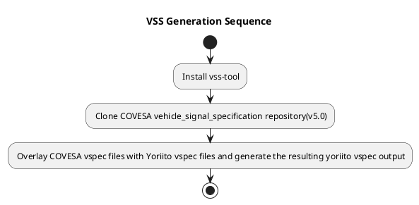

# Development Guide for Yoriito VSS

This page covers only the following two topics:
- How to manage vspec files overlaying signals defined by COVESA VSS
- How to create `yoriito_vss`

> **Note:** The method for determining which signals to overlay is a design-level concern and is outside the scope of this document.

## Managing VSS+α-β

The `vss` folder in this repository is managed on a per-vss-branch basis.

| Directory | Description |
| --- | --- |
| `vehicle/` | Stores vspec files to overlay signals directly under `vehicle` |
| `vehicle/body/` | Stores vspec files to overlay signals within `body` |
| `vehicle/cabin/` | Stores vspec files to overlay signals within `cabin` |

- Files should be created per leaf (terminal) branch.

**File naming examples:**

```text
Body.vspec   — Use when overlaying signals directly under Body
Hood.vspec   — Use when overlaying signals directly under Hood
```

> **Note:** Adding deeply nested branches under Body (as shown below) is not a common use case and is excluded from consideration.
>
> Body.NewBranch.NewBranch2.NewSignal

## Creation Procedure

VSS Json/CSV files are generated automatically via a **GitHub Actions commit trigger**.

Refer to `scripts/create_vspec.sh` for details.





## Additional Notes

### Pull Request Guidelines

In the yoriito-vss repository, a GitHub Action is configured to run automatically when a pull request is created. This Action performs the following steps:

1. Fetch the original VSS.
2. Overlay the original VSS with vspec files in this repository.
3. Generates the VSS output files (tree, JSON, and CSV).
4. Commits the generated files automatically.

Because of this, **differences will appear between the remote and local branches** after a pull request is created.

To avoid this discrepancy, it is recommended to run the following script locally **before committing**:

```bash
./scripts/create_vspec.sh
```
